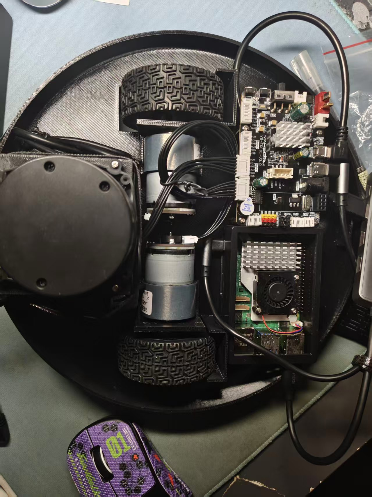

# XBot---扫地机器人(目前还在基础的开发验证阶段，)

This repositories was created by Davy Refss and FssTat-re together.
由 **Davy Refss** 与 **FssTat-re** 共同开发。项目覆盖从嵌入式电机控制、串口通信协议、ROS 2 驱动与里程计，到遥控、激光雷达、SLAM 与 Gazebo 仿真的完整链路。
后续会加上大扭矩舵机加在驱动轮上，使其成为轮足扫地机器人。

- **下位机**：STM32F103RCT6 + FreeRTOS
- **上位机**：树莓派5

我将会开源所有的包括但不限于PCB,3D打印零件,固件源码,使用的ROS包,物料清单。


## 目录结构
该目录下的文件也在测试!!!
```
Xbot/
├── firmware/
│   └── core_control/          # STM32 下位机固件（STM32CubeMX + CMake + FreeRTOS）
│       ├── Core/              # CubeMX 生成：HAL 外设初始化、FreeRTOS
│       ├── Drivers/           # STM32F1 HAL / CMSIS
│       ├── Middlewares/       # FreeRTOS
│       ├── source/            # 用户代码
│       │   ├── app/           # 应用任务
│       │   ├── service/       # 业务逻辑
│       │   ├── bsp/           # 板级驱动
│       │   └── osal/          # RTOS 抽象层
│       ├── tools/             # 调参 / 电池查询 / 曲线绘图脚本
│       └── CMakeLists.txt     # arm-none-eabi 交叉编译
├── ros2_pkg/                  # ROS 2 工作区
│   └── src/
│       ├── xbot_serial/       # 串口驱动 + 里程计 + 协议编解码
│       ├── xbot_control/      # 键盘遥控（teleop）
│       ├── xbot_lidar/        # 雷达扫描数据处理
│       ├── robot_description/ # URDF / STL 网格 / RViz / Gazebo
│       ├── xbot_slam/         # slam_toolbox 在线建图配置
│       ├── xbot_test/         # 预留的空包
│       └── ydlidar_ros2_driver/ # 第三方 YDLIDAR 驱动
└── tools/
    ├── serial-studio.html     # 浏览器串口调试工具（单文件、离线）
    └── selftest/              # serial-studio 的自检脚本
```


## 作者

- Davy Refss
- FssTat-re